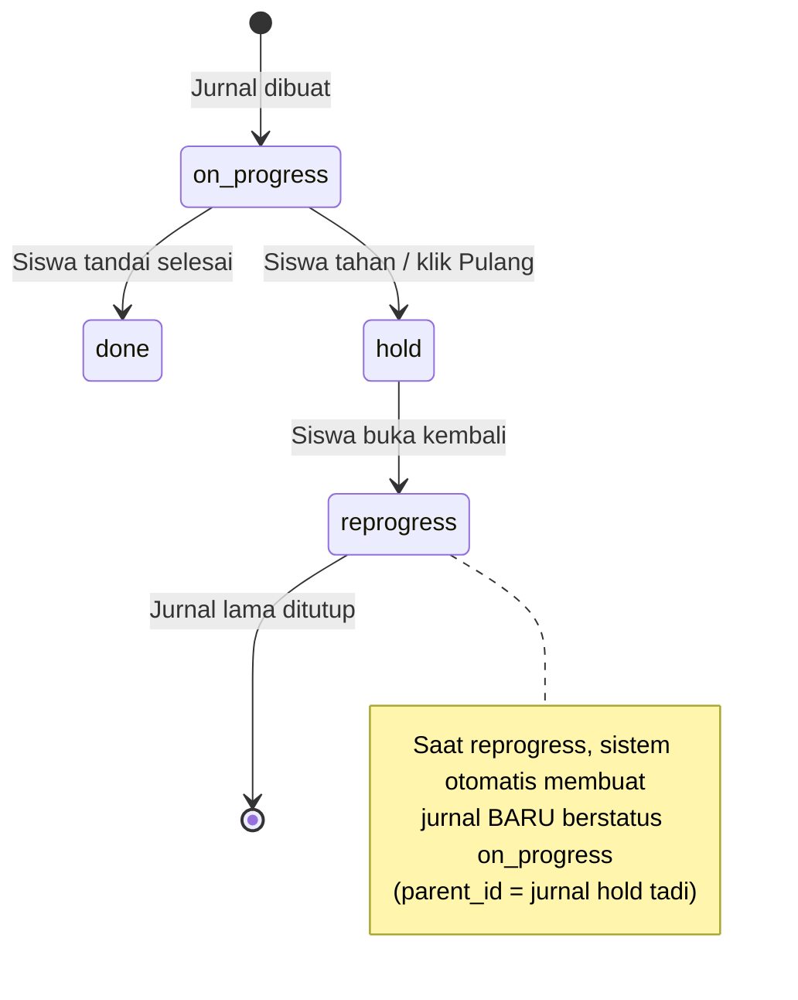
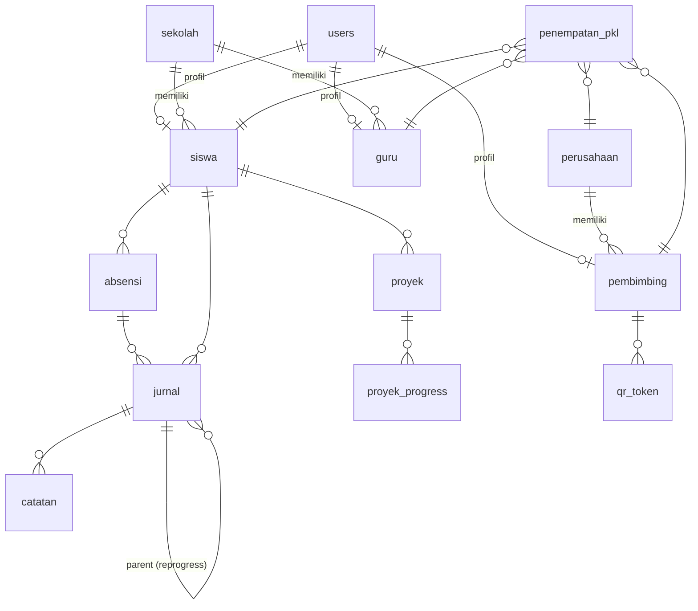

# Aplikasi Jurnal PKL Siswa (Laravel)

Dokumen spesifikasi awal: peran pengguna, alur kerja, desain database, aturan bisnis, halaman, dan laporan.

---

## 1. Ringkasan

Aplikasi web untuk memantau Praktik Kerja Lapangan (PKL) siswa. Siswa absen dengan scan barcode/QR yang ditampilkan pembimbing, mengisi jurnal kegiatan harian, dan melihat catatan dari pembimbing serta pesan dari guru. Guru memantau siswa dari sekolahnya saja. Superadmin mengelola seluruh data master.

**Stack**

| Komponen | Pilihan |
|---|---|
| Framework | Laravel (versi LTS terbaru yang didukung server) |
| Frontend | Blade + template dari folder `template/` |
| Database | MySQL |
| Timezone | `Asia/Jakarta` (`config/app.php`) |
| Barcode/QR (generate) | `simplesoftwareio/simple-qrcode` |
| Scan via kamera browser | `html5-qrcode` (JS) |
| Export laporan | `barryvdh/laravel-dompdf` (PDF — format sederhana dahulu, bisa disesuaikan nanti) |
| Auth | Laravel Breeze/UI atau auth manual + middleware role |

---

## 2. Peran Pengguna (Multi-user)

| Role | Deskripsi | Cakupan data |
|---|---|---|
| `superadmin` | Mengelola semua data master dan akun | Semua sekolah & perusahaan |
| `guru` | Guru pembimbing dari sekolah | Hanya siswa dari **sekolahnya sendiri** |
| `pembimbing` | Karyawan perusahaan tempat PKL | Hanya siswa yang ditempatkan padanya |
| `siswa` | Peserta PKL | Hanya data miliknya sendiri |

Implementasi: satu tabel `users` dengan kolom `role`, dilindungi middleware `role:siswa`, `role:guru`, dst. Setelah login, user diarahkan ke dashboard sesuai role.

---

## 3. Alur Kerja

### 3.1 Login
Satu halaman login untuk semua role. Redirect otomatis ke dashboard sesuai role.

### 3.2 Superadmin
Input dan kelola data: sekolah, perusahaan, akun guru, akun pembimbing, akun siswa, penempatan PKL (siswa ↔ perusahaan ↔ pembimbing ↔ guru), periode PKL, dan pengaturan jam kerja.

### 3.3 Siswa
1. **Dashboard**: tombol **Scan Barcode**.
2. Scan barcode milik pembimbing → sistem mencatat ke tabel `absensi` lengkap dengan **tanggal, jam, menit, detik**.
3. Setelah absen masuk, siswa dapat **input jurnal harian** (boleh lebih dari 1 kegiatan per hari):
   - Judul kegiatan
   - Deskripsi
   - Kesulitan yang dihadapi (opsional)
   - Status jurnal (lihat 3.6)
4. Siswa dapat melihat **catatan pembimbing** pada jurnalnya dan **pesan dari guru**.
5. Siswa dapat **mengajukan izin/sakit** untuk hari tersebut (tanggal, jenis, keterangan, lampiran opsional) jika tidak bisa hadir. Pengajuan langsung mengisi `absensi` hari itu dengan status `izin`/`sakit` (tanpa alur persetujuan bertingkat di versi awal).
6. Di akhir hari klik tombol **Pulang**:
   - Muncul konfirmasi.
   - Jika masih ada jurnal berstatus `on_progress`, sistem memberi peringatan bahwa jurnal tersebut akan diubah menjadi `hold`.
   - Jika dikonfirmasi: semua jurnal `on_progress` hari itu → `hold`, jam pulang tercatat di `absensi`.

### 3.4 Pembimbing (karyawan perusahaan)
1. **Dashboard**: menampilkan **barcode/QR** untuk discan siswa.
2. Melihat jurnal harian siswa bimbingannya.
3. Memberi **catatan** pada jurnal (tips penyelesaian, evaluasi, dll.).
4. Melihat kehadiran dan laporan siswa bimbingannya.

### 3.5 Guru
Melihat **kehadiran, jurnal, dan catatan pembimbing** siswa dari sekolahnya. **Tidak bisa** melihat data sekolah lain. Dapat mengirim pesan ke siswa. Mengakses menu laporan.

### 3.6 Status Jurnal

| Status | Arti |
|---|---|
| `on_progress` | Sedang dikerjakan |
| `done` | Selesai |
| `hold` | Sedang dikerjakan tetapi ditinggalkan dulu (kesulitan/alasan lain) |
| `reprogress` | Jurnal `hold` yang dibuka kembali |



**Aturan reprogress:** jurnal lama diubah menjadi `reprogress` (riwayat tetap ada), lalu dibuat **jurnal baru** `on_progress` dengan `parent_id` menunjuk ke jurnal lama. Dengan begitu rantai pengerjaan satu kegiatan bisa ditelusuri.

---

## 4. Desain Database

### 4.1 ERD



### 4.2 Tabel Utama

#### `jurnal`
| Kolom | Tipe | Keterangan |
|---|---|---|
| id | bigint PK | |
| siswa_id | FK → siswa | |
| penempatan_id | FK → penempatan_pkl | |
| absensi_id | FK → absensi | Absensi hari itu |
| parent_id | FK → jurnal, nullable | Diisi jika hasil reprogress |
| tanggal | date | |
| judul | string | Judul kegiatan |
| deskripsi | text | |
| kesulitan | text, nullable | |
| status | enum | `on_progress`, `done`, `hold`, `reprogress` |
| hold_at | datetime, nullable | |
| done_at | datetime, nullable | |
| unlocked_by | FK → users, nullable | Superadmin yang membuka kunci jurnal `done` ini |
| unlocked_at | datetime, nullable | |
| timestamps | | |

Aturan kunci: jurnal `done` tidak bisa diedit kecuali `unlocked_by` diisi oleh superadmin (lewat ID jurnal). Setelah diedit ulang dan disimpan, sebaiknya `unlocked_by`/`unlocked_at` direset agar kembali terkunci.

Index: `(siswa_id, tanggal)`, `(status)`.

#### `absensi`
| Kolom | Tipe | Keterangan |
|---|---|---|
| id | bigint PK | |
| siswa_id | FK → siswa | |
| penempatan_id | FK → penempatan_pkl | |
| qr_token_id | FK → qr_token, nullable | Token yang discan |
| tanggal | date | |
| jam_masuk | datetime | Termasuk detik |
| jam_pulang | datetime, nullable | Diisi saat klik Pulang |
| status | enum | `hadir`, `terlambat`, `izin`, `sakit`, `alpa` |
| keterangan | string, nullable | Alasan izin/sakit atau catatan lain |
| lampiran | string, nullable | Path file pendukung izin/sakit (opsional) |
| timestamps | | |

Unique: `(siswa_id, tanggal)` agar tidak ada absen ganda per hari.

#### `catatan`
| Kolom | Tipe | Keterangan |
|---|---|---|
| id | bigint PK | |
| jurnal_id | FK → jurnal, nullable | Null jika pesan umum |
| siswa_id | FK → siswa | Penerima |
| pengirim_id | FK → users | Pembimbing atau guru |
| tipe | enum | `catatan_jurnal` (pembimbing → siswa), `pesan` (guru → siswa) |
| isi | text | |
| dibaca_at | datetime, nullable | |
| timestamps | | |

### 4.3 Tabel Bantu

| Tabel | Kolom penting | Fungsi |
|---|---|---|
| `users` | name, username/email, password, role, is_active | Akun semua role |
| `sekolah` | nama, npsn, alamat, telepon, logo | Data sekolah |
| `perusahaan` | nama, alamat, bidang_usaha, telepon, latitude, longitude, radius_meter | Tempat PKL |
| `siswa` | user_id, sekolah_id, nis, kelas, jurusan, telepon | Profil siswa |
| `guru` | user_id, sekolah_id, nip, telepon | Profil guru |
| `pembimbing` | user_id, perusahaan_id, jabatan, telepon | Profil pembimbing |
| `penempatan_pkl` | siswa_id, perusahaan_id, pembimbing_id, guru_id, tanggal_mulai, tanggal_selesai, status | Menghubungkan siswa, perusahaan, pembimbing, dan guru. **Satu siswa hanya boleh punya satu penempatan aktif** dalam satu periode (unique constraint pada `siswa_id` where `status = 'aktif'`). Satu guru boleh membimbing siswa di lebih dari satu perusahaan. |
| `qr_token` | pembimbing_id, token, expired_at | Token barcode yang berganti berkala |
| `proyek` | siswa_id, penempatan_id, judul, deskripsi, diberikan_oleh, tanggal_mulai, target_selesai, tanggal_selesai, status, hasil | Proyek non-harian |
| `proyek_progress` | proyek_id, keterangan, persen, lampiran | Update progres proyek |
| `jurnal_lampiran` | jurnal_id, path, tipe | Foto/dokumen bukti kegiatan (opsional) |
| `jurnal_status_log` | jurnal_id, dari_status, ke_status, user_id, waktu | Riwayat perubahan status |
| `pengaturan_absensi` | perusahaan_id, jam_masuk, batas_terlambat, jam_pulang_min | Aturan jam kerja |
| `hari_libur` | tanggal, keterangan | Opsional |
| `notifications` | (bawaan Laravel) | Notifikasi catatan/pesan baru |

---

## 5. Aturan Bisnis

**Absensi**
- Satu siswa hanya boleh satu absen masuk per hari.
- Barcode berupa **token yang berganti setiap 30–60 detik** dan hanya berlaku untuk siswa yang ditempatkan pada pembimbing tersebut. Ini mencegah absen lewat foto/screenshot barcode yang dibagikan.
- Status `terlambat` otomatis jika `jam_masuk` melewati batas di `pengaturan_absensi`.
- Tidak ada validasi lokasi (GPS) saat absen — cukup mengandalkan token QR dinamis dari pembimbing.
- Siswa dapat mengisi `absensi` berstatus `izin`/`sakit` sendiri (self-service, tanpa persetujuan) untuk hari ia tidak hadir.

**Jurnal**
- Jurnal hanya bisa dibuat setelah siswa absen masuk hari itu.
- Satu hari boleh banyak jurnal.
- Siswa hanya bisa mengubah jurnalnya sendiri; jurnal berstatus `done` **dikunci total** dari sisi siswa/pembimbing/guru. Jika perlu diedit, **superadmin** membuka kunci dengan memasukkan **ID jurnal** tertentu (bukan buka massal), lalu siswa bisa mengedit kembali.
- Setiap perubahan status dicatat di `jurnal_status_log`.

**Pulang**
- Tombol Pulang hanya aktif jika sudah absen masuk dan belum absen pulang.
- Jurnal `on_progress` otomatis menjadi `hold` setelah konfirmasi.
- Opsional: scheduler (`php artisan schedule:run`) menutup absensi yang lupa pulang pada tengah malam.

**Hak akses data**
- Guru: semua query difilter `sekolah_id` milik guru tersebut. Gunakan **Global Scope** atau **Policy** agar tidak ada celah kebocoran antarsekolah.
- Pembimbing: difilter lewat `penempatan_pkl.pembimbing_id`.
- Siswa: difilter `siswa_id` miliknya.

**Komunikasi**
- Untuk versi awal, pesan/catatan hanya satu arah: pembimbing → siswa (catatan jurnal) dan guru → siswa (pesan). Belum ada kanal komunikasi guru ↔ pembimbing.

---

## 6. Halaman per Role

### Siswa
| Halaman | Isi |
|---|---|
| Dashboard | Tombol scan, status absen hari ini, tombol Pulang, ringkasan jurnal |
| Scan | Kamera untuk scan barcode |
| Jurnal | Daftar, tambah, edit, ubah status (done/hold/reprogress) |
| Catatan | Catatan pembimbing per jurnal dan pesan guru |
| Proyek | Daftar proyek dan update progres |
| Laporan | Rekap pribadi |
| Profil | Data diri, ganti password |

### Pembimbing
| Halaman | Isi |
|---|---|
| Dashboard | Barcode/QR (auto refresh), daftar siswa yang sudah absen hari ini |
| Siswa Bimbingan | Daftar siswa |
| Jurnal Siswa | Lihat jurnal, tambah catatan |
| Proyek | Beri proyek ke siswa, pantau progres |
| Laporan | Kehadiran, jurnal, proyek |

### Guru
| Halaman | Isi |
|---|---|
| Dashboard | Ringkasan siswa sekolahnya (hadir hari ini, jurnal terbaru) |
| Siswa | Daftar siswa sekolahnya |
| Kehadiran | Rekap kehadiran |
| Jurnal & Catatan | Jurnal dan catatan pembimbing |
| Pesan | Kirim pesan ke siswa |
| Laporan | Kehadiran, jurnal, proyek |

### Superadmin
CRUD: sekolah, perusahaan, guru, pembimbing, siswa, penempatan PKL, pengaturan absensi, hari libur, serta seluruh laporan dan manajemen akun (reset password, nonaktifkan).

---

## 7. Menu Laporan

| Laporan | Isi | Filter | Format |
|---|---|---|---|
| **Kehadiran** | Tanggal, jam masuk, jam pulang, durasi, status | Siswa, sekolah, perusahaan, rentang tanggal | Layar, PDF |
| **Jurnal Kegiatan** | Tanggal, judul, deskripsi, kesulitan, status, catatan pembimbing | Siswa, status, rentang tanggal | Layar, PDF |
| **Proyek** | Judul, pemberi proyek, periode, progres, status, hasil | Siswa, status | Layar, PDF |

Laporan proyek mirip jurnal tetapi **tidak harian**: satu proyek berlangsung beberapa hari/minggu dengan update progres berkala.

Format PDF masih **sederhana/seadanya** (belum ada kop atau layout khusus sekolah) — akan disempurnakan setelah format resmi tersedia.

---

## 8. Struktur Route (Ringkas)

```php
Route::middleware('guest')->group(fn () => Route::get('/login', ...));

Route::middleware(['auth', 'role:superadmin'])->prefix('admin')->name('admin.')->group(function () {
    // sekolah, perusahaan, guru, pembimbing, siswa, penempatan, laporan
});

Route::middleware(['auth', 'role:siswa'])->prefix('siswa')->name('siswa.')->group(function () {
    // dashboard, absen.scan, absen.pulang, jurnal, catatan, proyek, laporan
});

Route::middleware(['auth', 'role:pembimbing'])->prefix('pembimbing')->name('pembimbing.')->group(function () {
    // dashboard (barcode), siswa, jurnal, catatan, proyek, laporan
});

Route::middleware(['auth', 'role:guru'])->prefix('guru')->name('guru.')->group(function () {
    // dashboard, siswa, kehadiran, jurnal, pesan, laporan
});
```

---

## 9. Contoh Logika Inti

**Absen masuk (siswa scan)**

```php
public function scan(Request $request)
{
    $token = QrToken::where('token', $request->token)
        ->where('expired_at', '>', now())
        ->firstOrFail();

    $penempatan = auth()->user()->siswa->penempatanAktif;
    abort_unless($penempatan->pembimbing_id === $token->pembimbing_id, 403);

    Absensi::firstOrCreate(
        ['siswa_id' => $penempatan->siswa_id, 'tanggal' => today()],
        [
            'penempatan_id' => $penempatan->id,
            'qr_token_id'   => $token->id,
            'jam_masuk'     => now(),   // termasuk detik
            'status'        => 'hadir', // hitung terlambat via pengaturan_absensi
        ]
    );

    return back()->with('success', 'Absen masuk berhasil.');
}
```

**Pulang**

```php
public function pulang()
{
    DB::transaction(function () {
        $siswa   = auth()->user()->siswa;
        $absensi = Absensi::where('siswa_id', $siswa->id)->whereDate('tanggal', today())->firstOrFail();

        Jurnal::where('siswa_id', $siswa->id)
            ->whereDate('tanggal', today())
            ->where('status', 'on_progress')
            ->update(['status' => 'hold', 'hold_at' => now()]);

        $absensi->update(['jam_pulang' => now()]);
    });
}
```

**Reprogress**

```php
public function reprogress(Jurnal $jurnal)
{
    abort_unless($jurnal->status === 'hold', 422);

    DB::transaction(function () use ($jurnal) {
        $jurnal->update(['status' => 'reprogress']);

        Jurnal::create([
            'siswa_id'      => $jurnal->siswa_id,
            'penempatan_id' => $jurnal->penempatan_id,
            'absensi_id'    => Absensi::hariIni($jurnal->siswa_id)->id,
            'parent_id'     => $jurnal->id,
            'tanggal'       => today(),
            'judul'         => $jurnal->judul,
            'deskripsi'     => $jurnal->deskripsi,
            'status'        => 'on_progress',
        ]);
    });
}
```

---

## 10. Struktur Folder & Integrasi Template

```
project/
├── template/                 # template tampilan yang akan disertakan
├── app/
│   ├── Http/Controllers/{Admin,Siswa,Pembimbing,Guru}/
│   ├── Http/Middleware/RoleMiddleware.php
│   ├── Models/
│   ├── Policies/
│   └── Exports/
├── resources/views/
│   ├── layouts/              # layout hasil konversi dari template
│   ├── auth/
│   ├── admin/ siswa/ pembimbing/ guru/
│   └── components/
└── public/assets/            # aset (css/js/img) dari template
```

Langkah integrasi template: pindahkan aset ke `public/assets`, pecah HTML template menjadi `layouts/app.blade.php` + partial (`sidebar`, `navbar`, `footer`), lalu buat menu sidebar dinamis per role.

---

## 11. Urutan Pengerjaan

1. **Fondasi**: install Laravel, timezone, auth, middleware role, integrasi template.
2. **Master data**: sekolah, perusahaan, guru, pembimbing, siswa, penempatan (CRUD superadmin).
3. **Absensi**: barcode pembimbing, scan siswa, tombol pulang.
4. **Jurnal**: CRUD, status, hold otomatis saat pulang, reprogress.
5. **Catatan & pesan**: catatan pembimbing, pesan guru, notifikasi.
6. **Proyek**: pemberian proyek dan progres.
7. **Laporan**: kehadiran, jurnal, proyek + export PDF/Excel.
8. **Finishing**: policy & global scope, testing lintas role, seeder demo, deploy.

---

## 12. Keputusan yang Sudah Dikonfirmasi

- [x] Barcode berupa **QR code dinamis** (berganti berkala) — **disetujui**.
- [x] Satu siswa **hanya boleh satu penempatan aktif** per periode (tidak bisa pindah perusahaan di tengah jalan pada versi ini).
- [x] Siswa **bisa mengajukan izin/sakit** lewat aplikasi (self-service, langsung mengisi `absensi`, tanpa alur persetujuan bertingkat).
- [x] **Tidak perlu** validasi lokasi (GPS) saat absen.
- [x] Komunikasi **satu arah**: guru/pembimbing → siswa. Guru ↔ pembimbing belum dibutuhkan.
- [x] Jurnal `done` **dikunci total**; hanya superadmin yang bisa membuka kunci per ID jurnal untuk diedit ulang.
- [x] Laporan **format PDF saja**, layout masih sederhana/seadanya, disempurnakan setelah ada format resmi dari sekolah.
- [x] Satu guru **bisa** membimbing siswa di lebih dari satu perusahaan (lewat `penempatan_pkl`).
